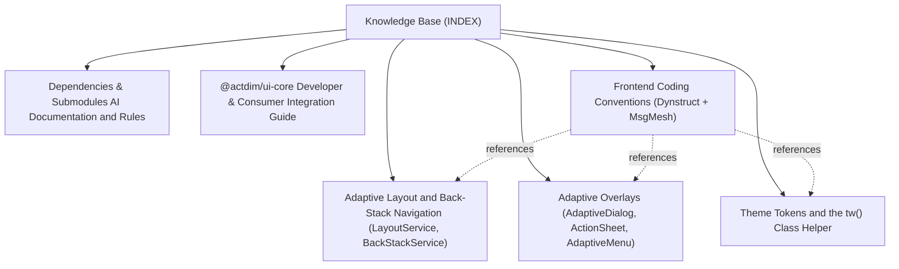

# @actdim/ui-core - Knowledge Base Topic Index

Central entry point and cross-linked topic catalog for project documentation:

## Knowledge Graph & Topic Map

---

## Articles

- **[Adaptive Layout and Back-Stack Navigation (LayoutService, BackStackService)](./topic--adaptive-layout.md)** (reference) `layout`, `tiers`, `safe-area`, `backstack`, `navigation`, `dynstruct`, `msgmesh`
- **[Adaptive Overlays (AdaptiveDialog, ActionSheet, AdaptiveMenu)](./topic--adaptive-overlays.md)** (reference) `overlays`, `dialogs`, `drawers`, `menus`, `backstack`, `dynstruct`
- **[Dependencies & Submodules AI Documentation and Rules](./topic--dependencies.md)** (topic) `dependencies`, `ai-context`, `submodules`, `vendor`, `rules`
- **[@actdim/ui-core Developer & Consumer Integration Guide](./topic--developer-guide.md)** (guide) `developer-guide`, `integration`, `adoption`, `migration`, `theming`, `tailwind`, `dynstruct`, `overlays`
- **[Frontend Coding Conventions (Dynstruct + MsgMesh)](./topic--frontend-conventions.md)** (reference) `conventions`, `dynstruct`, `msgmesh`, `theme`, `overlays`, `rules`
- **[Theme Tokens and the tw() Class Helper](./topic--theme-tokens.md)** (reference) `theme`, `design-tokens`, `tailwind`, `styling`, `mui`, `conventions`

---

## Related Context

- [AGENTS.md](../AGENTS.md): Active protocol conventions and rules.
- [Decisions (ADRs)](./decisions/INDEX.md): Architectural Decision Records.
- Active Issues & History: Tracked in `.along/` (see `AGENTS.md`).
