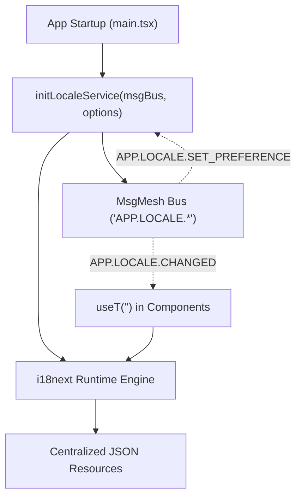

# UI Internationalization Foundation (@actdim/ui-core/i18n)

The `@actdim/ui-core/i18n` package provides the centralized, reactive internationalization foundation for Actdim applications. It encapsulates `i18next` behind typed MsgMesh contracts, offers React hooks for live language switching, and includes memoized Intl-based formatting helpers.

---

## 1. Architecture & Flow



### Runtime Lifecycle
1. `initLocaleService(msgBus, options)` is awaited before the initial application render.
2. The service resolves the active locale in strict order:
   `user preference` > `stored preference` > `host locale (MAUI)` > `navigator languages` > `fallback locale`.
3. Boot namespaces (`ui-core` and app boot namespaces) are loaded.
4. `<html lang dir>` attributes are synchronized on `document.documentElement`.
5. An `APP.LOCALE.CHANGED` message is dispatched on the bus.
6. When `APP.LOCALE.SET_PREFERENCE` is received, missing namespaces for the target locale are loaded first before switching the runtime language, preventing flashes of untranslated keys.

---

## 2. Key Naming & Resource Structure

All translations follow a strict semantic hierarchy:

```text
<ns>.<area>.<item>
```

- `<ns>`: Namespace name corresponding to the JSON file name (e.g. `ui-core`, `common`, `auth`, `media`).
- `<area>`: Screen, component, or semantic subdomain (e.g. `dialog`, `menu`, `login`).
- `<item>`: Specific text element in camelCase (e.g. `cancelButton`, `title`, `confirmPassword`).

### Resource File Layout

Resources are centralized at package or application level and never colocated inside feature subfolders:

```text
src/locales/
  en/
    ui-core.json
    common.json
  ru/
    ui-core.json
    common.json
```

---

## 3. MessageDescriptor Pattern

For components, models, and async error handlers that store or pass text references before rendering, use `MessageDescriptor`:

```typescript
export type MessageDescriptor = {
    key: string;
    params?: Record<string, unknown>;
    fallback?: string;
};
```

`AdaptiveDialog`, `AdaptiveMenu`, and `ActionSheet` accept both string literals and `MessageDescriptor` objects for titles, subtitles, and action labels.

To resolve a descriptor into a translated string at render time:

```typescript
import { translate } from '@actdim/ui-core/i18n';

const text = translate({
    key: 'ui-core:dialog.close',
    fallback: 'Close',
});
```

---

## 4. React Integration (useT and createTypedT)

Components consume translations via `useT`:

```typescript
import { useT } from '@actdim/ui-core/i18n';

export const MyComponent = () => {
    const t = useT('ui-core');

    return (
        <button type="button">
            {t('dialog.close')}
        </button>
    );
};
```

When the active locale changes via `APP.LOCALE.SET_PREFERENCE`, components using `useT` or `useLocale` re-render automatically via `useSyncExternalStore`.

### Strongly Typed Keys

Applications derive strictly type-checked translation hooks using `createTypedT`:

```typescript
import { createTypedT } from '@actdim/ui-core/i18n';
import type enResources from '@/locales/en';

export const useAppT = createTypedT<typeof enResources>();

// In a component:
const t = useAppT('common');
t('confirm'); // Type-checked: typos produce compile-time errors!
```

### In dynstruct components

In dynstruct components, `t()` (and formatters like `formatNumber`, `formatDate`) is reactive inside `view`, bindings (`bind(() => t(...))`), computed property getters, and effects. It automatically registers a dependency on the i18n runtime revision via `fromExternalStore`:

```typescript
import { t } from '@actdim/ui-core/i18n';
import { bind } from '@actdim/dynstruct/componentModel/core';

// In def:
view: () => <span>{t('common.save')}</span>,
children: {
    child: useChild({
        label: bind(() => t('common.cancel')), // Follows language changes live
    }),
},
```

A `t()` result passed as a plain parameter to a hook-constructor (e.g. `label: t('common.cancel')`) or stored as a static prop default is frozen at creation time. Always wrap translated parameters with `bind(() => t(...))` or translate in `view` / computed getters.

Plain React components continue using `useT` and `useLocale`.

---

## 5. Formatters

All date, time, number, byte, and duration formatting must use the centralized formatters instead of ad-hoc JavaScript helpers:

```typescript
import {
    formatDate,
    formatDateTime,
    formatNumber,
    formatBytes,
    formatDuration,
    formatRelative,
    formatList,
} from '@actdim/ui-core/i18n';

// Dates and numbers
formatDate(new Date()); // "10/21/2026" (en) or "21.10.2026" (ru)
formatDateTime(new Date()); // "10/21/2026, 03:30 PM"
formatNumber(1250000); // "1,250,000" (en) or "1 250 000" (ru)

// Storage and duration
formatBytes(1572864); // "1.5 MB" (en) or "1,5 МБ" (ru)
formatDuration(3660, { style: 'short' }); // "1 hr 1 min" (en) or "1 ч 1 мин" (ru)
formatDuration(7200, { style: 'long' }); // "2 hours" (en) or "2 часа" (ru)

// Relative time and lists
formatRelative(-1, 'day'); // "yesterday" (en) or "вчера" (ru)
formatList(['One', 'Two', 'Three']); // "One, Two, and Three"
```

All formatters automatically bind to the active application locale and memoize `Intl.*` formatter instances.

---

## 6. Server Error Codes Rule

The backend server never returns human-facing display text as its contract:
1. Backend responses carry a mandatory `errorCode` and optional `params` in `errorResponse`.
2. Client-side error classifiers map `errorCode` to a semantic translation key (e.g. `errors.codes.STORAGE_FULL`).
3. Raw error text from the server is strictly reserved for developer debugging logs and diagnostic overlays.

---

## 7. Adding a New Language

Adding support for an additional language requires no code changes:
1. Create a new directory under `src/locales/<locale-code>/` (e.g. `src/locales/de/`).
2. Add corresponding JSON files with identical keys matching `en`.
3. Register the locale code in `supportedLocales` during `initLocaleService`.
4. Run `pnpm run i18n:check` to verify complete key parity.

---

## 8. Tooling & Linting

- **Key Parity Check**: Run `pnpm run i18n:check` (or `checkLocaleParity` from `@actdim/ui-core/i18n-tooling`) to verify that all translated files match the keys of the base `en` locale.
- **ESLint Rule**: `eslint-plugin-i18next` enforces `i18next/no-literal-string` in `jsx-text-only` mode across `src/components/**` to prevent untranslated text literals.
